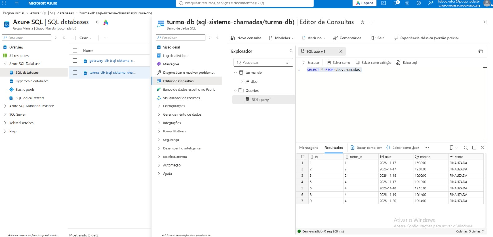
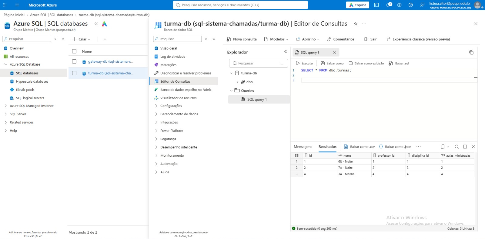
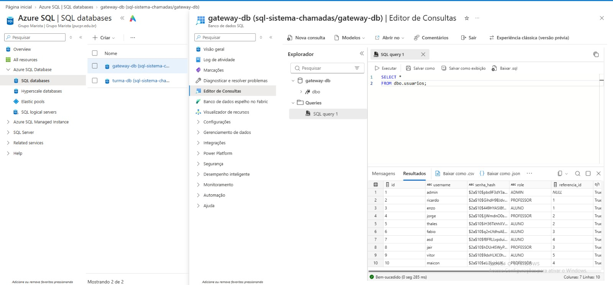
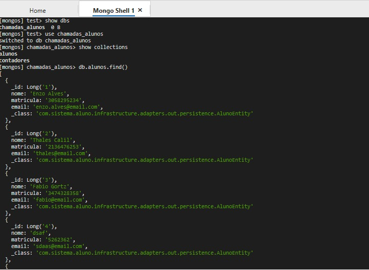

# Sistema de Chamadas - Backend

> **Vídeo de demonstração do sistema:** https://youtu.be/aqNFj_S9aUA
>
> **Como executar localmente** (frontend, backend e API Gateway): [docs/EXECUCAO_LOCAL.md](docs/EXECUCAO_LOCAL.md)
> · **Arquitetura (arc42):** [docs/arc42.md](docs/arc42.md)

## Serviços

| Serviço | Banco | Responsabilidade |
|---|---|---|
| `aluno-service` (porta 8081) | Azure Cosmos DB for MongoDB (vCore) | Alunos (id `Long` por sequência) |
| `turma-service` (porta 8083) | Azure SQL | Professores, disciplinas, turmas, **matrículas, chamadas e presenças** |

O antigo `chamada-service` foi **incorporado ao `turma-service`**: menos um App Service e um banco Azure SQL, e as
validações que eram feitas por HTTP entre os dois (turma existe? aluno matriculado? turma tem chamadas?) agora são
locais, na mesma transação.

## Subir do zero no Azure

### Recursos

1. **Azure SQL**: um servidor com 2 bancos — `turma-db` (turma-service) e `gateway-db` (usuários do API Gateway).
   Em *Rede*, marque **Permitir que serviços e recursos do Azure acessem este servidor**; TLS mínimo 1.2.
2. **Azure Cosmos DB for MongoDB (vCore)** para o aluno-service (libere no firewall o acesso dos serviços do Azure).
3. **Service Bus**: tópico `chamadas-topic` com a subscription `aluno-service-sub`.
4. **App Services (Java 17)**: `aluno-service` e `turma-service` (mais o do API Gateway, no outro repositório).
5. Os workflows (`.github/workflows`) publicam com o perfil de publicação de cada App Service: secrets `AZURE_PUBLISH_PROFILE_ALUNO` e `AZURE_PUBLISH_PROFILE_TURMA`.

### Variáveis de ambiente (App Service > Configurações > Variáveis de ambiente)

| Variável | aluno-service | turma-service | Valor |
|---|:-:|:-:|---|
| `JWT_SECRET` | x | x | **Mesmo valor do API Gateway** (32+ caracteres) |
| `SPRING_DATA_MONGODB_URI` | x | | Connection string do Cosmos DB (`mongodb+srv://...`) |
| `AZURE_SQL_URL` | | x | `jdbc:sqlserver://<servidor>.database.windows.net:1433;database=turma-db;encrypt=true;trustServerCertificate=false;hostNameInCertificate=*.database.windows.net;loginTimeout=30;` |
| `AZURE_SQL_USERNAME`, `AZURE_SQL_PASSWORD` | | x | Credenciais do Azure SQL |
| `AZURE_SERVICEBUS_CONNECTION_STRING` | x | x | Connection string do namespace do Service Bus |
| `TURMA_SERVICE_URL` | x | | `https://<app do turma-service>.azurewebsites.net` |
| `ALUNO_SERVICE_URL` | | x | `https://<app do aluno-service>.azurewebsites.net` |

Opcionais: `AZURE_SERVICEBUS_TOPIC` (padrão `chamadas-topic`), `AZURE_SERVICEBUS_SUBSCRIPTION` (aluno-service, padrão
`aluno-service-sub`), `AZURE_SERVICEBUS_ENABLED=false` para rodar sem Service Bus, `JAVA_OPTS=-Xms256m -Xmx512m` (aluno-service).

Porta: os serviços usam `PORT` (App Service Linux); o aluno-service também aceita `HTTP_PLATFORM_PORT` (App Service Windows).

### Ordem de deploy

API Gateway → turma-service → aluno-service → frontend. O banco do turma-service é criado pelo Flyway na primeira subida
(V1 a V5).

## Segurança

Os serviços validam o JWT emitido pelo API Gateway (HS256, mesmo `JWT_SECRET`) e aplicam a regra por perfil:

- **ADMIN**: tudo (turmas, matrículas, chamadas, presenças e cadastros).
- **PROFESSOR**: leitura geral; abre, registra presença em lote, finaliza e exclui chamadas **apenas das próprias turmas**.
- **ALUNO**: somente `GET` dos próprios dados (`/api/alunos/{seuId}`, `/api/turmas/aluno/{seuId}`, `/api/presencas/aluno/{seuId}`).

## Endpoints do turma-service

| Rota | Quem |
|---|---|
| `GET /api/turmas`, `GET /api/turmas/{id}` | ADMIN; PROFESSOR (as suas); ALUNO (as que cursa) |
| `POST/PUT/DELETE /api/turmas`, `/api/professores`, `/api/disciplinas` (409 para código de disciplina ou turma repetidos) | ADMIN |
| `GET /api/turmas/{id}/alunos`; `POST /api/turmas/{id}/alunos`; `DELETE /api/turmas/{id}/alunos/{alunoId}` | leitura: ADMIN e professor da turma; escrita: ADMIN |
| `GET /api/turmas/aluno/{alunoId}`, `GET /api/turmas/professor/{professorId}/alunos` | conforme o perfil |
| `POST /api/chamadas`, `GET /api/chamadas/turma/{turmaId}`, `GET /api/chamadas/{id}` | ADMIN; PROFESSOR da turma |
| `POST /api/chamadas/{id}/presencas/lote` — `{ "presencas": [{"alunoId":1,"presente":true}], "finalizar": true }` | ADMIN; PROFESSOR da turma |
| `PUT /api/chamadas/{id}` (editar data/horário de chamada aberta), `PUT /api/chamadas/{id}/finalizar`, `DELETE /api/chamadas/{id}` | ADMIN; PROFESSOR da turma |
| `GET /api/presencas/turma/{turmaId}` | ADMIN; PROFESSOR da turma |
| `GET /api/presencas/aluno/{alunoId}` | ADMIN; PROFESSOR; ALUNO (só o próprio) |

## Banco de dados (Flyway, turma-service)

| Migração | Conteúdo |
|---|---|
| V1 | professores, disciplinas, turmas |
| V2 | matrículas (`turma_alunos`), `aulas_ministradas` |
| V3 | chamadas (FK para turmas, uma por turma/data/horário) e presenças (uma por aluno/chamada) |
| V4 | `outbox_eventos` |
| V5 | `chamadas.horario` garantido como `TIME NOT NULL` (com `sendTimeAsDatetime=false` no driver, corrige o erro TIME x DATETIME ao criar chamada) |

## Service Bus

- Ao finalizar uma chamada, o turma-service grava na **mesma transação**: status FINALIZADA, `aulas_ministradas + 1` e o
  evento na tabela `outbox_eventos`. O envio ao tópico `chamadas-topic` acontece a cada 5 s.
- O **aluno-service** consome o evento; confirma a mensagem só depois de processar, e falhas repetidas vão para a
  Dead-Letter Queue.

## Erros

Todos os erros retornam JSON com `status`, `mensagem`, `servico` e `caminho` (404 não encontrado, 409 conflito/regra,
403 acesso negado, 502 falha ao chamar outro serviço). Erros 500 aparecem com stack trace no Log stream do App Service.

## Testes

`mvn test` em cada serviço. No turma-service: 3 regras de arquitetura (ArchUnit), 5 testes unitários das regras de
turma, chamada e presença e 3 testes de edição (chamada e disciplina).

## Execução local

Passo a passo completo (bancos em Docker, variáveis, ordem e portas): [docs/EXECUCAO_LOCAL.md](docs/EXECUCAO_LOCAL.md).

## Evidências no banco de dados

As capturas abaixo foram tiradas **diretamente nos bancos de dados** do Azure, consultando as tabelas e coleções pelo Editor de Consultas do Azure SQL e pelo Mongo Shell do Cosmos DB. Elas comprovam que os cadastros, turmas e chamadas feitos durante o [vídeo de demonstração](https://youtu.be/aqNFj_S9aUA) foram **persistidos de fato** no banco relacional (**Azure SQL**) e no banco NoSQL (**Azure Cosmos DB for MongoDB**).

**1. Azure SQL — banco `turma-db`, tabela `dbo.chamadas`** (`SELECT * FROM dbo.chamadas`): chamadas criadas e finalizadas, com turma, data, horário (`TIME`) e status `FINALIZADA`.

**2. Azure SQL — banco `turma-db`, tabela `dbo.turmas`** (`SELECT * FROM dbo.turmas`): turmas com professor, disciplina e o contador `aulas_ministradas`, somado a cada chamada finalizada.

**3. Azure SQL — banco `gateway-db`, tabela `dbo.usuarios`** (`SELECT * FROM dbo.usuarios`): logins de administrador, professores e alunos, com senha guardada só como hash BCrypt e `referencia_id` apontando para o professor (turma-service) ou o aluno (aluno-service).

**4. Azure Cosmos DB for MongoDB — banco `chamadas_alunos`, coleção `alunos`** (`db.alunos.find()`): alunos cadastrados pela aba Usuários, com id numérico (`Long`) gerado pela coleção `contadores`.

Problemas encontrados: 
1. Ao instalar o vitejs, dava problema de versão por ser a versão mais recente não carregando os módulos ao testar, a solução encontrada foi dar um downgrade de versão nos remotes para 7.3.0 do vite e para 5.1.4 do react. 
2. Ao tentar utilizar o TypeScript como linguagem, havia conflito com o module federation, assim ao usar o federation, o código não entendia o que era o método.

Comandos para atualizar e rodar após alterar:

npm run build:remotes
npm run start
